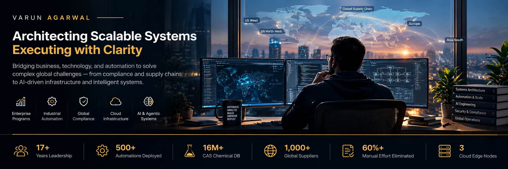

<!-- Profile README for github.com/varunagarwal-pro -->

  

**Enterprise Program Leadership · Systems Architecture · AI & Automation**

*Turning complex operational challenges into secure, scalable systems and measurable business outcomes.*

---

## 👋 About Me

I work at the intersection of **enterprise program leadership, global material compliance, process automation, and AI-enabled systems engineering**.

Across **17+ years**, my career has moved from financial governance and operational improvement to global compliance programs at HP and hands-on work with automation, cloud infrastructure, and software projects. I enjoy finding the underlying problem, designing a practical solution, and making the result reliable enough to operate and maintain.

My professional portfolio brings together the broader career story and project case studies: **[varun.agarwal.pro](https://varun.agarwal.pro)**.

## 📊 Impact at a Glance

| **17+ years** | **500+** | **1,000+** | **16M+** |
|:---:|:---:|:---:|:---:|
| Enterprise experience | Automations delivered | Suppliers in compliance programs | CAS chemical records referenced in compliance AI work |

Figures are from my professional portfolio and describe work across enterprise programs; they are not GitHub contribution counts.

## 🧭 What I Work On

<table>
<tr>
<td width="50%" valign="top">

### 🏢 Enterprise Programs & Governance
Cross-functional program delivery, global supplier readiness, auditability, regulatory compliance, and operational risk.

### ⚙️ Automation & Process Engineering
Workflow automation, ERP-connected processes, reporting, scripting, and reducing repetitive manual work.

</td>
<td width="50%" valign="top">

### 🤖 AI & Agentic Engineering
Practical LLM workflows, AI coding assistants, reusable agent skills, and AI-enabled knowledge and compliance systems.

### ☁️ Systems & Infrastructure
Self-hosted services, DNS operations, secure network design, multi-node administration, and infrastructure automation.

</td>
</tr>
</table>

## 🛠️ Selected Projects

### 🌐 [Technitium DNS Companion](https://github.com/varunagarwal-pro/Technitium-DNS-Companion)
A companion application for managing multiple Technitium DNS servers. The project brings operational workflows together, including query-log analysis, domain controls, scheduling, alerts, and authentication.

**Engineering themes:** DNS operations · Security-conscious access · Operational tooling · Performance

### 🧠 [Agent Skills](https://github.com/varunagarwal-pro/agent-skills)
Reusable workflows for AI coding agents, based on upstream open-source work. The repository should be read alongside its upstream attribution and license.

**Engineering themes:** AI-assisted development · Repeatable workflows · Engineering quality

### 📈 AstraQuant
A private project to develop a structured quantitative trading research environment, spanning market data, technical analysis, strategy development, backtesting, and validation.

*The repository is private and is not linked here.*

> Some repositories are forks or adaptations of upstream projects. Their individual READMEs and licenses identify the relevant origin and attribution.

## 🧠 Engineering Principles

- **Understand before automating** — map the problem, constraints, and desired outcome first.
- **Design for operations** — make systems observable, maintainable, and predictable under failure.
- **Security is an architectural concern** — use explicit trust boundaries and least-privilege access.
- **Measure the result** — validate performance and business impact with evidence.
- **Make knowledge reusable** — document decisions and turn repeatable work into reliable workflows.

## 🔭 Current Interests

AI-assisted engineering · Local LLMs · Agentic workflows · Cloud infrastructure · Security & observability · Quantitative research

## 🤝 Connect

For the full career journey, additional case studies, and professional background, visit **[varun.agarwal.pro](https://varun.agarwal.pro)**.

- 💼 [LinkedIn](https://www.linkedin.com/in/varunagarwalz/)
- 💻 [GitHub repositories](https://github.com/varunagarwal-pro?tab=repositories)
- 🌐 [Professional portfolio](https://varun.agarwal.pro)

---

*Leadership grounded in execution. Systems designed for the real world.*

